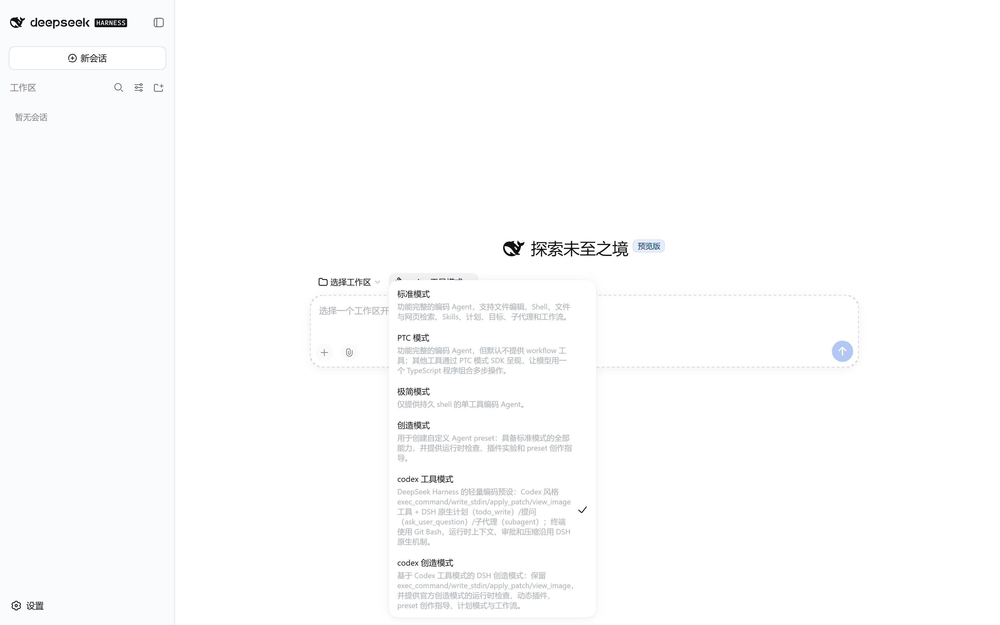
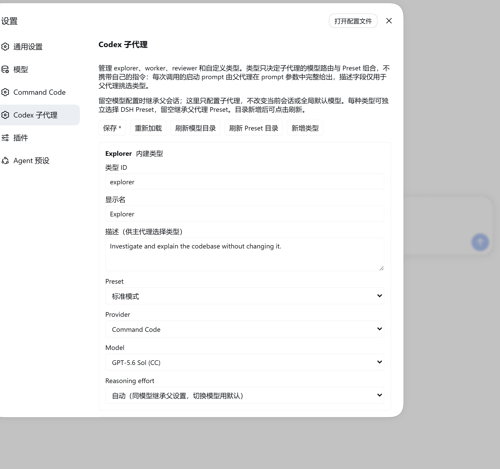

# dsh-codex-mode

A lightweight Codex-shaped coding mode for DeepSeek Harness. It borrows the tool
names and the editing workflow Codex users already know, without reimplementing
Codex's runtime context, approval policy or compactor.

It is built for GPT-family models: the package ships both OpenAI routes (Chat
Completions and Responses API), and the two agent presets it publishes can be
selected as-is from a new DSH session.



## What it provides

- `exec_command` / `write_stdin` — a DSH shell adapter that keeps the long-command
  polling and output-truncation behaviour.
- `apply_patch` — a freeform patch editor; this is the preferred file-editing tool.
- `win32-atomic-write-fallback` — a Windows host row. On ReFS, or NTFS files whose
  inherited ACL grants only Modify, the official atomic write fails with
  `SetFileSecurityW` EACCES; this row falls back to `rename` so `apply_patch`,
  `write` and `edit` can still land on disk.
- `view_image` — local image viewing.
- DSH-native tools: planning (`todo_write`), questions (`ask_user_question`),
  subagents (`subagent` / `subagent_fork`, plus `send_message` /
  `interrupt_agent` / `list_agents`), and `web_search`.
- OpenAI Chat Completions and Responses API routes.
- The **Codex tool mode** preset: a short coding prompt, `AGENTS.md` instruction
  loading, the tool rows above, and the DSH-native goal surface.
- The **Codex creative mode** preset: the same Codex tool surface plus the official
  creative-mode (`cordis`) capabilities — `tool-cordis`, composition/plugin skills,
  plan mode, goals, workflow and ralph.
- Both presets mount the DSH-native skill surface (`skill-filesystem` + `tool-skill`):
  local skill roots are discovered, the session catalog carries `<available_skills>`,
  and the composer's `/` menu lists skills and inserts `/name`. The skill registry is a
  host row whose discovery and loader rows the web surface disables, so every preset
  that wants skills must mount them itself — **Codex tool mode** was missing both
  before 0.3.3, which showed up as an empty `/` menu and a `/name` typed by hand that
  stayed ordinary text.
- Both presets mount the DSH-native goal surface (`command-goal` + `tool-goal`):
  `/goal` plus the `create_goal` / `get_goal` / `update_goal` tools, which is what
  makes a long-running objective keep running across goal rounds. The web surface
  disables the host-plane copies of both rows for the same reason it disables the
  skill rows, and **Codex tool mode** was missing them before 0.3.4.
- Both presets' personas state that **waiting is not idleness**: a goal round is admitted
  on every idle transition, so handing the turn back to wait for a command you started
  spends the goal's round budget on `job_output` waits (see 0.3.5 below).

DSH itself keeps owning the working directory, runtime context, sandbox, approval,
compaction and host tools. The presets replace only the tool surface (Codex-shaped
terminal and patch tools); planning, questions and subagents all use the DSH-native
implementations. Nothing injects Codex's `<environment_context>` or
`<current_time_reminder>`. The creative-mode preset mounts a second `tool-cordis`;
the host row `share-cordis-inspect` lets it share the global inspect provider with
the official creative mode, avoiding `Service is already registered`.

## Install

```sh
dsh plugin --profile web add dsh-codex-mode
```

From a local checkout instead:

```sh
dsh plugin --profile web add file:/path/to/dsh-codex-mode
```

## Graphical subagent types

After installing, restart the existing DSH Web host and reload the page, then manage
types under **Settings → Codex subagent** (设置 → Codex 子代理):

- `explorer` — investigate code, locate implementations and dependencies.
- `worker` — carry out one focused implementation task and verify it.
- `reviewer` — independently check for defects, regressions and missing tests.
- Custom types — add a stable type id, a display name and a task description.
  Built-in types can be edited; custom types can be deleted.

Each type inherits the parent session's model by default, or can pin its own
provider, model and reasoning effort. The dropdowns come from the DSH-native LLM
service and cover every registered provider's advertised models; reasoning efforts
come from model metadata and are not hardcoded. What is stored here is subagent
configuration only: it never calls the session's model-switch interface, never
changes the main session or the global default model, and never copies API keys.
If a catalog read fails you can retry with refresh; saving uses the native DSH
settings revision check, so two open pages cannot silently overwrite each other.



### Types carry no instructions (0.3.0)

A type is a *delegation profile*: it selects the child's LLM route and its preset
composition, and its `description` is the only text the parent agent reads when
choosing. Every child's startup prompt comes entirely from the `prompt` argument of
that call — so the prompt must be self-contained: state the goal, the relevant
context, and every constraint the child must respect (including whether it may
modify files). A type name implies no behaviour on its own.

The `instructions` field from 0.2.x was removed. It used to be injected as the
native `persona`, as the child's `deployment:persona-prefix` system-prompt section,
which also overrode the selected preset's own persona. The field is still accepted
when reading an older persisted configuration, but it is dropped on both read and
write and cleaned up on the next save, so an upgrade never fails startup validation.

### Per-type preset (0.2.1)

Each type can also select its own DSH agent preset, which actually mounts that
preset's tools, plugins and skills — not just a different model. The dropdown comes
from native DSH preset discovery; click refresh after adding a preset. Leaving it
empty inherits the parent session's preset, and remains compatible with 0.2.0
configurations. Model selection and preset selection are independent of each other.
A broken or deleted preset reports an explicit error rather than silently falling
back to the parent preset, and the main session's or global default preset is never
changed. Native delegation approval policy and explicit sandbox overrides still apply.

A preset is an executable plugin composition, so only select presets you trust;
switching away does not preserve tool restrictions or plugin guards that were unique
to the parent preset, and a custom preset should not override the host's sandbox or
approval services. Both `subagent` and `subagent_fork` are supported. A created
subagent persists the preset it actually selected, so later edits to the type
configuration do not change that subagent when it is resumed. Inherited fork history
does not mean the parent preset's current tool set is preserved.

The execution adapter depends on the native subagent's synchronous setup/publish
commit contract; asynchronous preset loading happens only in a temporary scope and
never keeps mutating a child after cancellation. After upgrading DSH you must re-run
`npm run test:agents` — do not skip that compatibility check.

### Typed delegation is required

Both Codex presets require a typed call; a missing or unknown type is rejected by the
execution side:

```json
{"agent_type":"explorer","description":"Locate the auth flow","prompt":"Investigate where the login entry point and credential check live. Read files only and report back; do not modify anything."}
```

That argument works for both `subagent` and `subagent_fork`. Scheduling, background
notifications, depth limits, cancellation, and `send_message` / `list_agents` remain
the DSH-native implementation's responsibility.

Types grant no sandbox authority: a constraint such as "do not modify files" written
in `prompt` is behavioural guidance, not filesystem access control. The real limits
come from the selected preset's tool composition and the permission scope fixed at
delegation time.

After saving added or edited types, a session that has this extension mounted picks
up the new `agent_type` enum and selection guidance at the **next model request
assembly** — no new session, page reload or restart needed. New types reuse those two
stable tool entry points rather than registering a new function per type. Running
subagents keep the configuration they started with, and a model request already in
flight is never rewritten mid-stream. Upgrading from an older version for the first
time requires restarting the existing host and remounting the updated Codex presets;
an existing agent's composition cannot be changed hot.

## Testing

```bash
npm test        # full suite
npm run test:e2e
```

`npm test` covers the existing regressions plus type configuration, the native
delegation adapter and the settings page. `npm run test:e2e` drives real Chromium
with React DOM, the original client bundle and the real Cordis SettingsProvider,
covering create/edit/delete, model-effort selection and save conflicts. The E2E run
mocks only the model catalog; HTTP is bridged to the host handler through Playwright
routing, so it starts no replacement server and spends no real model quota. It does
not replace integration verification against a logged-in production GUI.

### Install-path regression (0.3.2)

`scripts/bundle-patch.smoke.js` guards the marketplace install path
(`dsh plugin --profile <name> add dsh-codex-mode`). It materialises a replica of the
**published** layout from `npm pack --dry-run --json`, then resolves every row of this
package's `cordis.patch.yml` inside it, asserting that at most one row is
client-bearing per package and that this package is client-bearing exactly once.

The test must replicate the published layout rather than inspect the working tree:
the repository carries `plugins/package.json` (private, named `dsh-codex`, **not in
the published `files` list**), which truncates the client-modules package-root walk
and makes path-like rows resolve to a package with no `dsh.client`. Checking in the
repository therefore reports a clean result, while the same bundle patch installed
into a real profile fails to boot.

Background: 0.3.0 mounted all seven rows with path-like specifiers
(`./plugins/x.js`). Every one resolved back to this package, so one package name
registered seven client sources and `client-modules` refused to compose — the
marketplace's own install command produced a profile that **could not boot**. That
defect was fixed in 0.3.1. This test keeps it from returning, and also catches the
class of problem that only shows up after install: a plugin row added without a
matching `files`/`exports` entry, and README screenshots that are referenced but not
shipped (which render as broken images on the registry page).

## Development

Test dependencies install in a clean clone; install the test browser with
`npx playwright install chromium`. The local `node_modules` here is a junction
pointing at the DSH dependencies — **do not run `npm install` on that junction**.
Instead install Playwright 1.60.0 and React/ReactDOM 18.3.1 in a separate directory
and point `DSH_E2E_DEPS` at its `node_modules`. `DSH_E2E_CHROMIUM` selects an
existing Chrome executable; `DSH_E2E_SCREENSHOT` sets a screenshot path.

On restart, the host row `codex-preset-publisher` **copies** the bundled
`agent-presets/codex` and `agent-presets/codex-creative` into
`$DSH_HOME/.agent-presets/` as real directories (not junctions). A new session can
then select the Codex tool mode or Codex creative mode preset. The
`openai-responses` route can pass `apply_patch` as a true freeform custom tool; the
Chat Completions route passes it as an ordinary function call.

Offline/development fallback: `scripts/install.ps1` can still copy the same presets
by hand and keeps the `$DSH_HOME/plugins` junction. Day-to-day users do not need it.

> **Preset discovery**: `dsh-agent-presets`'s `scanRoot` skips junctions and symlinks,
> so the publisher always writes real directories. Tool rows resolve through this
> package's exports (`dsh-codex-mode/plugins/tools/...`), so a copied preset does not
> depend on repository-relative paths. `replay-codex` is a frozen alignment copy, not
> a day-to-day coding preset. See `plugins/ACTIVATION.md` §5 for detailed
> troubleshooting.

## Verification

```bash
npm test
```

The suite covers preset module loadability, automatic preset publishing, the
behaviour of the retained tools, and both OpenAI routes. Each preset's
`agent-presets/*/check-rows.mjs` also asserts, as text, the rows whose absence
silently removes a whole surface: the compaction group, the package-export form of
the Codex tool rows, the skill surface (`skill-filesystem` + `tool-skill`), and the
goal surface (`command-goal` + `tool-goal`). The historical full Codex alignment
research is kept under `docs/` and is no longer part of this plugin's runtime
contract.

### Missing skill surface (0.3.3)

The **Codex tool mode** composition never mounted `skill-filesystem` or `tool-skill`.
DSH's skill registry (`dsh-skill`) is a host row, and the web surface disables the
discovery and loader rows beneath it (`disabled: true`) so that each preset mounts its
own — the **Codex creative mode** preset has done exactly that for as long as it has
shipped. A session on the plain preset therefore had no skill surface at all: no
`skill` tool, no `<available_skills>` catalog, and a composer `/` menu that resolved
through `skills/list` and failed outright while the registry was absent. Typing
`/name` by hand stayed ordinary text, because nothing was listening for the gesture.
The fix mounts both rows, and `check-rows.mjs` now guards them.

### Missing goal surface (0.3.4)

The same class of regression, in the same preset: no `command-goal` and no `tool-goal`
row. The `dsh-web-app` patch disables both host-plane rows, so a preset has to mount
its own — a session on **Codex tool mode** had no `/goal` command and none of
`create_goal` / `get_goal` / `update_goal`. A long-running request could therefore
never be turned into a persisted goal, and nothing would continue it after the turn
that described it, no matter how clearly the user asked for one. The fix mounts both
rows, `check-rows.mjs` guards them, and `scripts/verify-presets.mjs` now asserts the
goal surface structurally for both presets alongside the skill surface.

### Waiting is not idleness (0.3.5)

A goal round is admitted by the host-plane `dsh-goal-round-driver` on one condition:
`agent.status === "idle"`. It never asks whether that agent still owns running work, and a
Codex-shaped tool surface makes that gap expensive. `exec_command` yields a still-running
command after 10–30 s, so any longer command becomes a background job; the `dsh-tool-jobs`
prompt section then tells the model not to busy-poll because it will be notified when the job
finishes, so the model ends its turn to wait — and every such turn end is read as idleness, so
the driver immediately admits a round whose only productive action is another
`job_output({ wait: true })`. Measured on one live session: 18 injections, 11 of them (61%) pure
wait rounds, and 29 of 29 turn ends with an exec session still running; over the same period the
**standard** preset's 24 rounds contained **zero** wait rounds.

0.3.5 states the rule in both Codex personas: while a command or job you started is still
running, do not hand the turn back just to wait for it — keep the turn alive by polling until
the work settles, because ending a turn with an active goal spends a round of the goal's budget
on waiting. The structural fix belongs upstream (the idle gate should exclude an agent's
unfinished background work); the measured case, the cross-preset comparison, and the proposed
fixes are written up in `docs/upstream/2026-09-21-goal-round-driver-pending-jobs.md`, and
`scripts/goal-round-audit.mjs` reproduces every number in it from the local session store.

For a structural check — it parses the YAML and asserts the shape of each row,
which is stronger than the text assertions in `check-rows.mjs`, and accepts both the
bare package specifier and the `file:` URL the publisher rewrites it to:

```bash
node scripts/verify-presets.mjs "$DSH_HOME/.agent-presets"   # repo sources + published copies
```

For the goal-round audit — read-only, walks `$DSH_HOME/sessions`, decodes the concatenated-zstd
logs, and reports rounds, pure-wait rounds, and turn ends that left an exec session running, per
effective preset (a session switched mid-life is grouped by `agent-preset/selected`, not by its
header):

```bash
node scripts/goal-round-audit.mjs                     # every session + per-preset summary
node scripts/goal-round-audit.mjs --session 743812d8  # one session, round by round
```

## Related plugins

By the same author, listed in the [dsh plugin market](https://awesome-dsh-plugin.com/):

- [`dsh-llm-api-pool`](https://github.com/bainianlaoyao/dsh-llm-api-pool) — pool several
  OpenAI-compatible API keys and hot-switch by remaining balance.
- [`dsh-session-robustness`](https://github.com/bainianlaoyao/dsh-session-robustness) —
  keep long sessions recoverable.
- [`dsh-bash-on-windows`](https://github.com/bainianlaoyao/bash-on-windows) — make Git
  Bash the only terminal tool on Windows.
- [`dsh-easy-archive`](https://github.com/bainianlaoyao/easy-archive) — two-step inline
  archiving from the workspace sidebar.

## License

MIT
